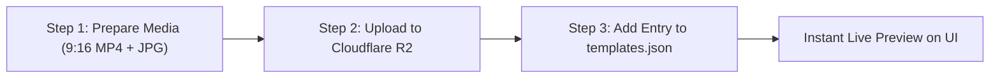

# Guide: How to Add a New Template to SayWith

## Overview & Quick Answer
> **Question:** *If I have a new template, do I just add a new entry in `templates.json` and will the UI automatically recognize that?*
>
> **Answer: YES, 100%!** The landing page UI is fully data-driven. The moment you add a new entry to [`public/data/templates.json`](file:///c:/Users/Admin/Desktop/PROJECTS/SayWith_System/SayWith/public/data/templates.json):
> - It **automatically creates the new card** in the catalog grid.
> - It **automatically handles desktop hover-to-play with audio** and pause on mouse leave.
> - It **automatically handles full-screen modal preview** on mobile tap or desktop click.
> - It **automatically generates the order inquiry link** (WhatsApp / Messenger) with the new template number and name.
> - It **automatically hooks into category filtering and real-time search**.

---

## 3-Step Workflow to Add a New Template



---

### Step 1: Prepare the Video & Thumbnail

For best mobile and desktop performance:
- **Aspect Ratio**: `9:16` (Vertical Mobile Phone format, e.g., `720×1280` or `1080×1920`).
- **Video Format**: `.mp4` (H.264 codec + AAC audio).
- **Duration**: Recommended `4` to `10` seconds (loops smoothly). You can also trim the preview loop point in the JSON (see `durationMs` / `duration` fields below).
- **Thumbnail / Poster**: `.jpg` (first frame or representative screenshot of the template).
- **File Naming Convention**:
  - Video: `template-51.mp4`
  - Thumbnail: `template-51.jpg`

---

### Step 2: Upload to Cloudflare R2

You have two easy ways to upload:

#### Option A: Automatic Upload via Script (Recommended)
1. Place your new video in:
   ```text
   assets/cloudflare_templates/videos/template-51.mp4
   ```
2. Place your new thumbnail in:
   ```text
   assets/cloudflare_templates/thumbnails/template-51.jpg
   ```
3. Run the automated upload command in the terminal:
   ```bash
   npm run upload:templates
   ```
   *The script will upload only new/missing files to Cloudflare R2 and output the public URLs.*

#### Option B: Cloudflare Web Dashboard
1. Go to [Cloudflare Dashboard](https://dash.cloudflare.com/) → **R2 Object Storage**.
2. Open bucket: **`saywith-data`**.
3. Upload to the corresponding folder:
   - Video → `templates/videos/template-51.mp4`
   - Poster → `templates/thumbnails/template-51.jpg`

> [!NOTE]
> Public R2 URLs follow this permanent format:
> - **Video**: `https://pub-4ec77915cbb84de6b020ec75ce082114.r2.dev/templates/videos/template-51.mp4`
> - **Poster**: `https://pub-4ec77915cbb84de6b020ec75ce082114.r2.dev/templates/thumbnails/template-51.jpg`
> *(These public URLs never expire).*

---

### Step 3: Add Entry to `templates.json`

Open [`public/data/templates.json`](file:///c:/Users/Admin/Desktop/PROJECTS/SayWith_System\SayWith\public\data\templates.json) and append a new JSON object at the end of the array:

```json
  {
    "id": 51,
    "num": "51",
    "name": "Celestial Starlight",
    "category": "Anniversary",
    "tag": "Constellation & Gold",
    "desc": "Cosmic golden starfield with glowing constellation memory nodes and soft ambient orchestral audio.",
    "accent": "from-indigo-900 via-purple-900 to-black",
    "previewType": "video",
    "previewUrl": "https://pub-4ec77915cbb84de6b020ec75ce082114.r2.dev/templates/videos/template-51.mp4",
    "posterUrl": "https://pub-4ec77915cbb84de6b020ec75ce082114.r2.dev/templates/thumbnails/template-51.jpg",
    "durationMs": 6500
  }
```

> [!TIP]
> `durationMs` / `duration` are **optional**. If omitted, the video loops natively for its full length.
> Both fields tell the UI's loop logic to restart the video at that exact point — giving you frame-accurate control over the preview loop without re-encoding the file.
> - **`durationMs`** (recommended) — loop restart point in **milliseconds** (e.g. `6500` = 6.5 s). Use for sub-second precision.
> - **`duration`** (alternative) — loop restart point in **seconds** (e.g. `6.5`). Same effect, different unit.
> - If **both** are set, `durationMs` takes priority.

---

## Field Reference Table

| Field | Type | Required | Description | Example |
| :--- | :--- | :---: | :--- | :--- |
| `id` | `number` | ✅ | Unique sequential integer ID | `51` |
| `num` | `string` | ✅ | Display number for badges and order references | `"51"` |
| `name` | `string` | ✅ | Title of the template displayed on card and modal | `"Celestial Starlight"` |
| `category` | `string` | ✅ | One of the categories: `Love & Romance`, `Anniversary`, `Birthday`, `Memorial & Tribute`, `Special Occasion`, `Minimalist`, `Modern & Creative`, `Artistic & Story` | `"Anniversary"` |
| `tag` | `string` | ✅ | Short 2–3 word highlight tag | `"Constellation & Gold"` |
| `desc` | `string` | ✅ | Concise description (1–2 sentences) | `"Cosmic golden starfield with glowing..."` |
| `accent` | `string` | ✅ | Tailwind gradient classes used as fallback poster background | `"from-indigo-900 via-purple-900 to-black"` |
| `previewType` | `string` | ✅ | `"video"` or `"image"` | `"video"` |
| `previewUrl` | `string` | ✅ | Direct public link to `.mp4` on Cloudflare R2 | `"https://pub-4ec77915cbb84de6b020ec75ce082114.r2.dev/templates/videos/template-51.mp4"` |
| `posterUrl` | `string` | ✅ | Direct public link to `.jpg` thumbnail poster on Cloudflare R2 | `"https://pub-4ec77915cbb84de6b020ec75ce082114.r2.dev/templates/thumbnails/template-51.jpg"` |
| `durationMs` | `number` | ☑️ Optional | Loop restart point in **milliseconds** — the video resets to 0 when it reaches this timestamp (sub-second precision). Takes priority over `duration` when both are set. | `6500` *(= 6.5 s)* |
| `duration` | `number` | ☑️ Optional | Loop restart point in **seconds** (e.g. `6.5`). Use if you prefer seconds over milliseconds. Ignored when `durationMs` is also set. | `6.5` |

---

## What Happens Automatically in the UI?

1. **Card Rendering**: The grid dynamically iterates over `templates.json`. Your new card will show up with the matching category, tag, and description.
2. **Hover with Audio**: On desktop, hovering un-mutes and plays the video. Moving the mouse away automatically pauses it.
3. **Full Screen Modal**: Clicking or tapping opens the mobile frame dialog with auto-playback, audio, and native video player controls.
4. **Order Link**: Clicking **"Inquire with This"** or **"Message to Order"** automatically sends a pre-filled message:
   ```text
   Hi SayWith! I want to order a custom digital presence with Template #51 (Celestial Starlight).
   ```
5. **Search & Filter**: Searching `"Celestial"` or filtering by `"Anniversary"` instantly matches and displays the template.

---

## Summary Checklist
- [ ] Rendered 9:16 MP4 video and JPG poster.
- [ ] Uploaded files to Cloudflare R2.
- [ ] Added new item in [`public/data/templates.json`](file:///c:/Users/Admin/Desktop/PROJECTS/SayWith_System/SayWith/public/data/templates.json).
- [ ] *(Optional)* Set `durationMs` or `duration` to trim the preview loop point.
- [ ] Saved file — no rebuild needed for local dev; changes display instantly!
